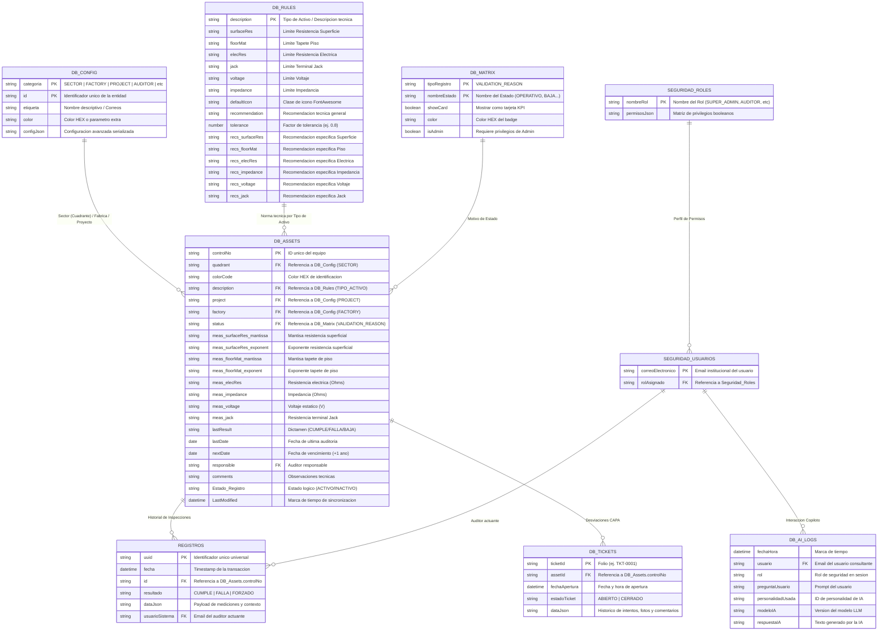

# Arquitectura de Base de Datos: Sistema ESD Control

Este documento describe la especificación técnica completa del modelo de datos del sistema **ESD Control**, implementado sobre **Google Sheets**, almacenamiento de objetos en **Google Drive** y almacenamiento clave-valor en **PropertiesService**.

---

## 1. Visión General del Modelo de Persistencia

El sistema implementa una arquitectura híbrida optimizada para el entorno de Google Workspace:
1. **Google Sheets (Motor Relacional Tabular):** Hoja de cálculo maestra identificada con `CONF.SS_ID = "1CiZnIPUbtw3eCpC2-Hsre6tKh647BSxOkZEk-8r85WA"`. Contiene las entidades maestras, transaccionales, parametrización y bitácoras de auditoría.
2. **Google Drive (Almacén de Objetos / Blobs):** Estructura jerárquica de directorios creada dinámicamente para resguardar archivos fotográficos de evidencia CAPA y reportes ejecutivos exportados.
3. **PropertiesService (Script Properties):** Caché persistente de baja latencia utilizada para configuración maestra, balanceo de API Keys de IA, control de concurrencia y secuenciadores atómicos de folios (`LockService`).

---

## 2. Diagrama Entidad-Relación (ERD)



---

## 3. Diccionario Detallado de Tablas (Google Sheets)

### 3.1. Tabla: `DB_Assets`
- **Constante:** `CONF.SHEET_ASSETS`
- **Propósito:** Inventario maestro de estaciones de trabajo, equipos e infraestructura protegida contra ESD.
- **Clave Primaria:** `controlNo` (Columna A).
- **Operaciones de Lectura:**
  - `getData()` en [`2_Core_Assets.js#L89`](file:///c:/Users/TEMP.NA.004/Documents/Visual%20Studio%202017/Aplicaciones%20calidad/ESD_Control/2_Core_Assets.js#L89): `shAssets.getDataRange().getValues()`.
  - `getUpdates()` en [`7_Utils_Logs.js#L88`](file:///c:/Users/TEMP.NA.004/Documents/Visual%20Studio%202017/Aplicaciones%20calidad/ESD_Control/7_Utils_Logs.js#L88): Lectura completa filtrada por fecha `LastModified`.
  - `askGemini()` en [`4_Service_AI.js#L34`](file:///c:/Users/TEMP.NA.004/Documents/Visual%20Studio%202017/Aplicaciones%20calidad/ESD_Control/4_Service_AI.js#L34): Lectura completa para contexto del LLM.
- **Operaciones de Escritura:**
  - `saveNewAsset()` en [`2_Core_Assets.js#L193`](file:///c:/Users/TEMP.NA.004/Documents/Visual%20Studio%202017/Aplicaciones%20calidad/ESD_Control/2_Core_Assets.js#L193): `sh.appendRow(row)`.
  - `processAudit()` en [`2_Core_Assets.js#L209-L235`](file:///c:/Users/TEMP.NA.004/Documents/Visual%20Studio%202017/Aplicaciones%20calidad/ESD_Control/2_Core_Assets.js#L209-L235): Escritura parcial por celdas (`setValue`) y rango técnico (`setValues` en columnas 8 a 16).
  - `adminDeleteAsset()` en [`2_Core_Assets.js#L280`](file:///c:/Users/TEMP.NA.004/Documents/Visual%20Studio%202017/Aplicaciones%20calidad/ESD_Control/2_Core_Assets.js#L280): Marcado lógico en columna `Estado_Registro`.
  - `bulkProcessAssets()` en [`5_Admin_DataHub.js#L225`](file:///c:/Users/TEMP.NA.004/Documents/Visual%20Studio%202017/Aplicaciones%20calidad/ESD_Control/5_Admin_DataHub.js#L225): Actualización masiva / inserción.

#### Columnas de `DB_Assets`:

| Col (1-based) | JS Idx (0-based) | Nombre de Campo | Tipo de Dato | Nulo / Obligatorio | Reglas / Valores Permitidos / Descripción |
| :---: | :---: | :--- | :--- | :---: | :--- |
| **1 (A)** | 0 | `controlNo` | String / Int | **Obligatorio (PK)** | Identificador único de inventario (ej. `"1001"`, `"ESD-052"`). |
| **2 (B)** | 1 | `quadrant` | String | Obligatorio | Código de sector o cuadrante físico en planta (ej. `"A1"`, `"SMT-02"`). |
| **3 (C)** | 2 | `colorCode` | String | Opcional | Código hexadecimal para representación visual en el mapa de planta. |
| **4 (D)** | 3 | `description` | String | **Obligatorio (FK)** | Tipo o familia del activo. Vinculado a `DB_Rules.description`. |
| **5 (E)** | 4 | `project` | String | Opcional | Proyecto o línea de ensamble asignada (ej. `"AUTOMOTIVE-X"`). |
| **6 (F)** | 5 | `factory` | String | Opcional | Planta o edificio de manufactura (ej. `"PLANTA 1"`). |
| **7 (G)** | 6 | `status` | String | Obligatorio | Estado operativo actual. Vinculado a `DB_Matrix.nombreEstado`. |
| **8 (H)** | 7 | `surfaceRes_mantissa` | String / Num | Opcional | Mantisa de la resistencia superficial (ej. `"1.5"`). |
| **9 (I)** | 8 | `surfaceRes_exponent` | String / Num | Opcional | Exponente de base 10 (ej. `"6"` representa $1.5 \times 10^6\ \Omega$). |
| **10 (J)** | 9 | `floorMat_mantissa` | String / Num | Opcional | Mantisa de resistencia del tapete de piso ESD. |
| **11 (K)** | 10 | `floorMat_exponent` | String / Num | Opcional | Exponente de resistencia del tapete de piso ESD. |
| **12 (L)** | 11 | `elecRes` | String / Num | Opcional | Resistencia eléctrica a tierra directa ($\Omega$). |
| **13 (M)** | 12 | `impedance` | String / Num | Opcional | Medición de impedancia ($\Omega$). |
| **14 (N)** | 13 | `voltage` | String / Num | Opcional | Voltaje electrostático inducido / cuerpo humano ($V$). |
| **15 (O)** | 14 | `jack` | String / Num | Opcional | Medición de conectores Jack de aterrizamiento ($\Omega$). |
| **16 (P)** | 15 | `lastResult` | String | Obligatorio | Dictamen de la última inspección (`"CUMPLE"`, `"FALLA"`, `"BAJA"`, `""`). |
| **17 (Q)** | 16 | `lastDate` | Date / String | Opcional | Fecha de la última inspección realizada (`"dd-MMM-yy"` o `yyyy-MM-dd`). |
| **18 (R)** | 17 | `nextDate` | Date / String | Opcional | Fecha programada de expiración de calibración / próxima auditoría. |
| **19 (S)** | 18 | `responsible` | String | Opcional | Nombre del auditor o encargado que efectuó la verificación. |
| **20 (T)** | 19 | `comments` | String | Opcional | Comentarios u observaciones del auditor. |
| **Dinámica** | Variable | `Estado_Registro` | String | Obligatorio | Creada por auto-configuración. Valores: `"ACTIVO"` o `"INACTIVO"` (soft delete). |
| **Dinámica** | Variable | `LastModified` | String ISO | Opcional | Marca de tiempo ISO-8601 (`stampLastModified`) para sincronización diferencial. |

---

### 3.2. Tabla: `DB_Rules`
- **Constante:** `CONF.SHEET_RULES`
- **Propósito:** Catálogo normativo de especificaciones técnicas ESD, límites de aceptación y recomendaciones por tipo de activo.
- **Clave Primaria:** `description` / `TIPO_ACTIVO_ID` (Columna A).
- **Operaciones de Lectura:**
  - `getData()` en [`2_Core_Assets.js#L28`](file:///c:/Users/TEMP.NA.004/Documents/Visual%20Studio%202017/Aplicaciones%20calidad/ESD_Control/2_Core_Assets.js#L28): `shRules.getDataRange().getValues()`.
- **Operaciones de Escritura:**
  - `adminSaveRule()` en [`6_Admin_Settings.js#L52`](file:///c:/Users/TEMP.NA.004/Documents/Visual%20Studio%202017/Aplicaciones%20calidad/ESD_Control/6_Admin_Settings.js#L52): Inserción o actualización de fila completa de 16 columnas.
  - `adminDeleteRule()` en [`6_Admin_Settings.js#L61`](file:///c:/Users/TEMP.NA.004/Documents/Visual%20Studio%202017/Aplicaciones%20calidad/ESD_Control/6_Admin_Settings.js#L61): `deleteRow()`.

#### Columnas de `DB_Rules`:

| Col (1-based) | JS Idx (0-based) | Nombre de Campo | Tipo de Dato | Descripción |
| :---: | :---: | :--- | :--- | :--- |
| **1 (A)** | 0 | `description` / `TIPO_ACTIVO_ID` | String | **PK.** Nombre identificador del tipo de equipo (ej. `"MESA ESD"`, `"SOLDADOR"`). |
| **2 (B)** | 1 | `surfaceRes` | String | Límite para resistencia superficial (ej. `"< 1.0E9"`). |
| **3 (C)** | 2 | `floorMat` | String | Límite para tapete de piso (ej. `"< 1.0E9"`). |
| **4 (D)** | 3 | `elecRes` | String | Límite para resistencia eléctrica directa (ej. `"< 1.0"`). |
| **5 (E)** | 4 | `jack` | String | Límite de resistencia de Jack (ej. `"< 5.0"`). |
| **6 (F)** | 5 | `voltage` | String | Límite máximo de voltaje estático permitido (ej. `"< 100"`). |
| **7 (G)** | 6 | `impedance` | String | Límite de impedancia a tierra (ej. `"< 2.0"`). |
| **8 (H)** | 7 | `defaultIcon` | String | Clase de icono FontAwesome (ej. `"fa-box"`, `"fa-tools"`, `"fa-microscope"`). |
| **9 (I)** | 8 | `recommendation` | String | Recomendación correctiva genérica ante desviación técnica. |
| **10 (J)** | 9 | `tolerance` | Number | Factor numérico de tolerancia (por defecto `0.8`). |
| **11 (K)** | 10 | `recs_surfaceRes` | String | Recomendación específica para falla en resistencia superficial. |
| **12 (L)** | 11 | `recs_floorMat` | String | Recomendación específica para falla en tapete de piso. |
| **13 (M)** | 12 | `recs_elecRes` | String | Recomendación específica para falla en resistencia eléctrica. |
| **14 (N)** | 13 | `recs_impedance` | String | Recomendación específica para falla en impedancia. |
| **15 (O)** | 14 | `recs_voltage` | String | Recomendación específica para falla en voltaje. |
| **16 (P)** | 15 | `recs_jack` | String | Recomendación específica para falla en conexiones jack. |

---

### 3.3. Tabla: `DB_Config`
- **Constante:** `CONF.SHEET_CONFIG`
- **Propósito:** Almacén maestro polimórfico de catálogos y parametrización general del sistema.
- **Clave Primaria Compuesta:** (`Categoría`, `ID`).
- **Operaciones de Lectura:**
  - `getData()` en [`2_Core_Assets.js#L44`](file:///c:/Users/TEMP.NA.004/Documents/Visual%20Studio%202017/Aplicaciones%20calidad/ESD_Control/2_Core_Assets.js#L44).
  - `adminGenerateFullReport()` en [`5_Admin_DataHub.js#L49`](file:///c:/Users/TEMP.NA.004/Documents/Visual%20Studio%202017/Aplicaciones%20calidad/ESD_Control/5_Admin_DataHub.js#L49).
- **Operaciones de Escritura:**
  - `adminSaveConfigItem()` en [`6_Admin_Settings.js#L17`](file:///c:/Users/TEMP.NA.004/Documents/Visual%20Studio%202017/Aplicaciones%20calidad/ESD_Control/6_Admin_Settings.js#L17).
  - `adminUpdateCatalogItem()` en [`6_Admin_Settings.js#L27`](file:///c:/Users/TEMP.NA.004/Documents/Visual%20Studio%202017/Aplicaciones%20calidad/ESD_Control/6_Admin_Settings.js#L27).
  - `adminDeleteConfigItem()` en [`6_Admin_Settings.js#L39`](file:///c:/Users/TEMP.NA.004/Documents/Visual%20Studio%202017/Aplicaciones%20calidad/ESD_Control/6_Admin_Settings.js#L39).

#### Columnas de `DB_Config`:

| Col (1-based) | JS Idx (0-based) | Nombre de Campo | Tipo de Dato | Descripción / Valores |
| :---: | :---: | :--- | :--- | :--- |
| **1 (A)** | 0 | `Categoría` | String | Discriminador polimórfico: `"SECTOR"`, `"FACTORY"`, `"PROJECT"`, `"AUDITOR"`, `"TEMPLATE"`, `"TICKET_FIELD"`, `"EMAIL_GROUP"`, `"AI_PROMPT"`. |
| **2 (B)** | 1 | `ID (Valor)` | String | Identificador único dentro de la categoría (ej. `"A1"`, `"PLANTA_1"`). |
| **3 (C)** | 2 | `Etiqueta / Correos` | String | Etiqueta visible al usuario, lista de emails o instrucción de prompt. |
| **4 (D)** | 3 | `Color / Configuración Extra` | String | Código hexadecimal de color para sectores (ej. `"#005565"`) o metadata. |
| **5 (E)** | 4 | `Configuraciones (JSON)` | String JSON | Objeto serializado para plantillas de reporte (`{ startRow: 8, columns: [...] }`). |

---

### 3.4. Tabla: `DB_Matrix`
- **Constante:** `CONF.SHEET_MATRIX`
- **Propósito:** Gestión de motivos de validación y estados físicos de los activos, con control de visualización en tarjetas KPI del dashboard.
- **Clave Primaria:** `Nombre del Estado` (Columna B, filtrado por Columna A = `"VALIDATION_REASON"`).
- **Operaciones de Lectura:**
  - `getData()` en [`2_Core_Assets.js#L72`](file:///c:/Users/TEMP.NA.004/Documents/Visual%20Studio%202017/Aplicaciones%20calidad/ESD_Control/2_Core_Assets.js#L72).
- **Operaciones de Escritura:**
  - `adminAddMatrixOption()`, `adminUpdateMatrixOption()`, `adminDeleteMatrixOption()` en [`6_Admin_Settings.js#L66-L102`](file:///c:/Users/TEMP.NA.004/Documents/Visual%20Studio%202017/Aplicaciones%20calidad/ESD_Control/6_Admin_Settings.js#L66-L102).

#### Columnas de `DB_Matrix`:

| Col (1-based) | JS Idx (0-based) | Nombre de Campo | Tipo de Dato | Descripción |
| :---: | :---: | :--- | :--- | :--- |
| **1 (A)** | 0 | `Tipo_Registro` | String | Fijo: `"VALIDATION_REASON"`. |
| **2 (B)** | 1 | `Nombre del Estado` | String | Nombre del estado o motivo (ej. `"OPERATIVO"`, `"BAJA"`, `"EN REPARACION"`). |
| **3 (C)** | 2 | `Mostrar Tarjeta` | Boolean | Define si el estado genera una tarjeta métrica en el dashboard principal. |
| **4 (D)** | 3 | `Color de Tarjeta` | String | Color hexadecimal para el badge o tarjeta (ej. `"#10b981"`). |
| **5 (E)** | 4 | `Es Administrativo` | Boolean | Si es `true`, solo perfiles administradores pueden asignar o remover este estado. |

---

### 3.5. Tabla: `Registros` (Bitácora Transaccional Inmutable)
- **Constante:** `CONF.SHEET_LOGS`
- **Propósito:** Registro histórico inmutable de cada evento de inspección o auditoría ESD realizado en la planta.
- **Clave Primaria:** `UUID` (Columna A).
- **Clave Foránea:** `ID` -> `DB_Assets.controlNo` (Columna C).
- **Operaciones de Lectura:**
  - `getData()` en [`2_Core_Assets.js#L18`](file:///c:/Users/TEMP.NA.004/Documents/Visual%20Studio%202017/Aplicaciones%20calidad/ESD_Control/2_Core_Assets.js#L18): Lectura completa para calcular conteo de auditorías por equipo.
  - `getAssetHistory()` en [`7_Utils_Logs.js#L63`](file:///c:/Users/TEMP.NA.004/Documents/Visual%20Studio%202017/Aplicaciones%20calidad/ESD_Control/7_Utils_Logs.js#L63): Lectura inversa para extraer los últimos 10 eventos de un activo.
- **Operaciones de Escritura:**
  - `logAudit()` en [`7_Utils_Logs.js#L55`](file:///c:/Users/TEMP.NA.004/Documents/Visual%20Studio%202017/Aplicaciones%20calidad/ESD_Control/7_Utils_Logs.js#L55): `sh.appendRow(...)`.

#### Columnas de `Registros`:

| Col (1-based) | JS Idx (0-based) | Nombre de Campo | Tipo de Dato | Descripción |
| :---: | :---: | :--- | :--- | :--- |
| **1 (A)** | 0 | `UUID` | String | **PK.** Generado con `Utilities.getUuid()`. |
| **2 (B)** | 1 | `FECHA` | DateTime | Timestamp exacto del guardado de la auditoría. |
| **3 (C)** | 2 | `ID` | String | **FK.** `controlNo` del activo auditado. |
| **4 (D)** | 3 | `RESULTADO` | String | Dictamen final (`"CUMPLE"`, `"FALLA"`, `"FORZADO"`). |
| **5 (E)** | 4 | `DATA` | String JSON | Estructura con lecturas metrológicas, comentarios, fechas calculadas y metadata. |
| **6 (F)** | 5 | `USUARIO_SISTEMA` | String | Correo del auditor obtenido de `Session.getActiveUser().getEmail()`. |

---

### 3.6. Tabla: `DB_Tickets`
- **Nombre:** `'DB_Tickets'` (creada dinámicamente si no existe)
- **Propósito:** Gestión y trazabilidad del ciclo de vida de tickets de Acción Correctiva y Preventiva (CAPA) por no conformidades ESD.
- **Clave Primaria:** `TICKET_ID` (Columna A).
- **Clave Foránea:** `ASSET_ID` -> `DB_Assets.controlNo` (Columna B).
- **Operaciones de Lectura:**
  - `getActiveTicketData()` en [`3_Core_Tickets.js#L124`](file:///c:/Users/TEMP.NA.004/Documents/Visual%20Studio%202017/Aplicaciones%20calidad/ESD_Control/3_Core_Tickets.js#L124): Búsqueda inversa del ticket abierto del activo.
  - `adminGenerateFullReport()` en [`5_Admin_DataHub.js#L26`](file:///c:/Users/TEMP.NA.004/Documents/Visual%20Studio%202017/Aplicaciones%20calidad/ESD_Control/5_Admin_DataHub.js#L26): Cruce de datos de tickets para reportes ejecutivos.
- **Operaciones de Escritura:**
  - `saveTicketRecord()` en [`3_Core_Tickets.js#L86-L110`](file:///c:/Users/TEMP.NA.004/Documents/Visual%20Studio%202017/Aplicaciones%20calidad/ESD_Control/3_Core_Tickets.js#L86-L110): `appendRow` para apertura y `setValue` para actualización de intentos o cierre.

#### Columnas de `DB_Tickets`:

| Col (1-based) | JS Idx (0-based) | Nombre de Campo | Tipo de Dato | Descripción |
| :---: | :---: | :--- | :--- | :--- |
| **1 (A)** | 0 | `TICKET_ID` | String | **PK.** Folio secuencial generado atómicamente (ej. `"TKT-0015"`). |
| **2 (B)** | 1 | `ASSET_ID` | String | **FK.** Identificador del activo asociado. |
| **3 (C)** | 2 | `FECHA_APERTURA` | String / DateTime | Formato `"yyyy-MM-dd HH:mm:ss"`. |
| **4 (D)** | 3 | `ESTADO_TICKET` | String | Estado del ticket: `"ABIERTO"` o `"CERRADO"`. |
| **5 (E)** | 4 | `DATA_JSON` | String JSON | Objeto estructurado que incluye datos de apertura, URLs de fotos de evidencia y array de re-evaluaciones (`intentos_medicion`). |

---

### 3.7. Tabla: `DB_AI_Logs`
- **Constante:** `CONF.SHEET_AI_LOGS`
- **Propósito:** Telemetría y auditoría de uso del Copiloto de IA (Gemini).
- **Operaciones de Escritura:** `logAiInteraction()` en [`4_Service_AI.js#L117`](file:///c:/Users/TEMP.NA.004/Documents/Visual%20Studio%202017/Aplicaciones%20calidad/ESD_Control/4_Service_AI.js#L117).

#### Columnas de `DB_AI_Logs`:

| Col (1-based) | JS Idx (0-based) | Nombre de Campo | Tipo de Dato | Descripción |
| :---: | :---: | :--- | :--- | :--- |
| **1 (A)** | 0 | `Fecha/Hora` | DateTime | Timestamp de la consulta. |
| **2 (B)** | 1 | `Usuario` | String | Correo del usuario que realizó la consulta. |
| **3 (C)** | 2 | `Rol` | String | Rol asignado del usuario en la sesión. |
| **4 (D)** | 3 | `Pregunta Usuario` | String | Prompt o pregunta enviada al asistente. |
| **5 (E)** | 4 | `Personalidad Usada`| String | ID de personalidad seleccionada en `DB_Config`. |
| **6 (F)** | 5 | `Modelo IA` | String | Nombre del modelo (`"Gemini 2.5 Flash"`). |
| **7 (G)** | 6 | `Respuesta IA` | String | Respuesta de texto generada por el LLM. |

---

### 3.8. Tablas de Seguridad: `Seguridad_Usuarios` y `Seguridad_Roles`
- **Propósito:** Persistencia secundaria y sincronización con el panel de administración de accesos.
- `Seguridad_Usuarios`:
  - **Col 1:** `Correo Electrónico` (String, PK).
  - **Col 2:** `Rol Asignado` (String, vinculado a rol: `"SUPER_ADMIN"`, `"AUDITOR"`, `"INVITADO"`).
- `Seguridad_Roles`:
  - **Col 1:** `Nombre del Rol` (String, PK).
  - **Col 2:** `Permisos (JSON)` (String JSON con flags: `{ canView, canAudit, canConfig, canUsers, canUseCopilot }`).

---

## 4. Almacenamiento Clave-Valor (`PropertiesService`)

Para evitar accesos lentos a Google Sheets en cada validación de credenciales o configuración, el sistema almacena parámetros en **ScriptProperties**:

| Clave de Propiedad | Tipo de Dato | Descripción y Esquema |
| :--- | :--- | :--- |
| `USERS_DB` | JSON String | Mapeo directo `{ [email: string]: "SUPER_ADMIN" \| "AUDITOR" \| "INVITADO" }`. |
| `ROLES_DB` | JSON String | Diccionario de roles y permisos booleanos. |
| `EMAIL_MASTER_CONFIG` | JSON String | Plantillas de notificación `{ OPEN: { to, subject, body }, CLOSE: {...}, FORCED: {...} }`. |
| `AI_COPILOT_CONFIG` | JSON String | Ajustes de IA `{ enabled: boolean, apiKeys: string[], activePromptId: string }`. |
| `SETTING_SHOW_PREV_EVIDENCE`| String (`"true"`/`"false"`) | Conmutador global para mostrar fotos previas en el formulario de inspección. |
| `FOLIO_TICKETS` | String numérico | Contador autoincremental atómico para folios de tickets CAPA. |
| `FOLIO_<TEMPLATE_ID>` | String numérico | Contador autoincremental para reportes generados desde plantillas DataHub. |

---

## 5. Estructura Jerárquica de Archivos en Google Drive

Las evidencias fotográficas y reportes generados no se insertan en celdas de Sheets, sino en el árbol de directorios de Google Drive gestionado por [`getFolderRecursive`](file:///c:/Users/TEMP.NA.004/Documents/Visual%20Studio%202017/Aplicaciones%20calidad/ESD_Control/3_Core_Tickets.js#L5):

```
Google Drive (Carpeta contenedora de la Hoja Maestra)
│
├── EVIDENCIA_ESD_PLEXUS/
│   └── {Fábrica}/                     (ej. "PLANTA 1")
│       └── {Proyecto}/                (ej. "AUTOMOTIVE")
│           └── {Año-Mes}/             (ej. "2026-10")
│               └── {ticketId}_{quadrant}_{desc}_{index}.jpg
│
├── REPORTES_ESD/
│   └── Reporte_{templateId}_{yyyy-MM-dd_HHmm}.gsheet
│
└── REPORTES_ESD_VISTAS_PREVIAS/
    └── VISTA_PREVIA_{templateId}_{yyyy-MM-dd_HHmm}.gsheet
```

---

## 6. Mapeo de Cuellos de Botella de I/O Identificados en Auditoría

Como referencia para la fase de optimización, a continuación se documentan los puntos críticos actuales en la manipulación de rangos:

1. **`bulkProcessAssets` ([`5_Admin_DataHub.js#L225`](file:///c:/Users/TEMP.NA.004/Documents/Visual%20Studio%202017/Aplicaciones%20calidad/ESD_Control/5_Admin_DataHub.js#L225)):**
   - **Comportamiento Actual:** Bucle de `sh.getRange(i + 1, col).setValue(...)` ejecutado 8 veces por fila en actualizaciones masivas.
   - **Riesgo:** Cuello de botella de tiempo de ejecución (N+1 HTTP calls).
2. **`getData()` ([`2_Core_Assets.js#L18`](file:///c:/Users/TEMP.NA.004/Documents/Visual%20Studio%202017/Aplicaciones%20calidad/ESD_Control/2_Core_Assets.js#L18)):**
   - **Comportamiento Actual:** `shLogs.getDataRange().getValues()` lee la tabla histórica completa de auditorías en cada arranque para contabilizar inspecciones.
   - **Riesgo:** Alto consumo de memoria y latencia creciente con el paso de los meses.
3. **`processAudit` ([`2_Core_Assets.js#L209`](file:///c:/Users/TEMP.NA.004/Documents/Visual%20Studio%202017/Aplicaciones%20calidad/ESD_Control/2_Core_Assets.js#L209)):**
   - **Comportamiento Actual:** 4 llamadas individuales `setValue()` antes de actualizar el rango de mediciones y 3 adicionales después.
   - **Mejora:** Unificar en una sola llamada continua `range.setValues(...)`.

