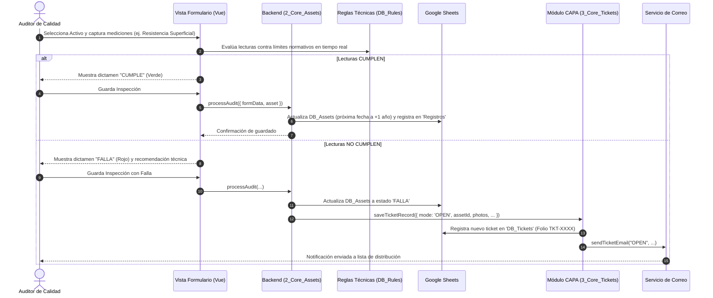
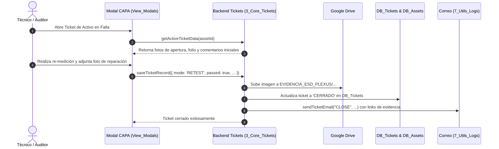
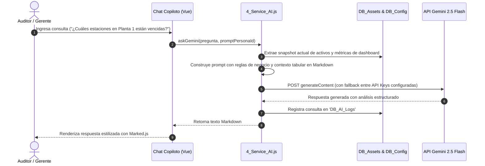

# Sistema de Control y Auditoría ESD (ESD Control Suite)

Sistema integral de grado industrial para la gestión, inspección metrológica, trazabilidad y resolución de desviaciones de Descargas Electrostáticas (ESD) en líneas de manufactura electrónica (Plexus Corp).

Desarrollado sobre la infraestructura de **Google Apps Script (V8)** y **Vue.js 3**, el sistema opera como una Single Page Application (SPA) conectada a Google Workspace (Sheets, Drive, Gmail) y potenciada por Inteligencia Artificial generativa mediante **Google Gemini 2.5 Flash**.

---

## 1. Propósito del Proyecto

En entornos de fabricación de ensambles electrónicos de alta fiabilidad, el control electrostático es un requisito crítico de calidad bajo la norma **ANSI/ESD S20.20** e **IEC 61340-5-1**. 

El propósito de este sistema es:
1. **Digitalizar y Automatizar la Verificación ESD:** Reemplazar registros manuales en papel por formularios reactivos con evaluación matemática instantánea contra normas técnicas según el tipo de activo (mesas, tapetes de piso, soldadores, ionizadores, pulseras, etc.).
2. **Gestión de Ciclo de Vida de Acciones Correctivas (CAPA):** Apertura automatizada de tickets de desviación ante fallas de medición, registro fotográfico de evidencias en Google Drive y re-inspección hasta el cumplimiento.
3. **Visibilidad Ejecutiva en Tiempo Real:** Dashboard con indicadores clave de desempeño (KPIs), control de vencimiento de calibraciones, estatus operativo y mapas de cuadrantes de planta.
4. **Asistencia Inteligente con Copiloto de IA:** Asistente conversacional con IA para auditores y líderes de calidad que analiza inventarios, tendencias de fallas y estándares normativos en lenguaje natural.

---

## 2. Arquitectura General y Stack Tecnológico

```mermaid
flowchart TD
    subgraph Cliente ["Capa Cliente (SPA en Navegador)"]
        UI["Vue.js 3 (Composition API)"]
        Tailwind["Tailwind CSS + FontAwesome 6"]
        SweetAlert["SweetAlert2 (Notificaciones/Modales)"]
        i18n["Vue-i18n (Multi-idioma ES/EN)"]
        Marked["Marked.js (Renderizado Markdown IA)"]
    end

    subgraph Middleware ["Capa Middleware (Google Apps Script V8)"]
        Router["Config.js (doGet / include)"]
        CoreAssets["2_Core_Assets.js (Motor de Activos e Inspecciones)"]
        CoreTickets["3_Core_Tickets.js (Gestión de Tickets CAPA)"]
        ServiceAI["4_Service_AI.js (Integración Gemini Flash)"]
        DataHub["5_Admin_DataHub.js (Import/Export masivo y Reportes)"]
        Settings["6_Admin_Settings.js (Catálogos, Reglas y RBAC)"]
        UtilsLogs["7_Utils_Logs.js (Sincronización, Logs y Correos)"]
    end

    subgraph Persistencia ["Capa de Persistencia y Servicios Cloud"]
        SS[("Google Sheets (Base de Datos Relacional)")]
        Drive["Google Drive (Almacenamiento de Fotos y Reportes)"]
        Props["PropertiesService (Caché y Parámetros Globales)"]
        Mail["Gmail / MailApp (Alertas por Correo)"]
        Gemini["Google Gemini API (v1beta REST)"]
    end

    UI <-->|google.script.run (RPC asíncrono)| Router
    Router --> CoreAssets & CoreTickets & ServiceAI & DataHub & Settings & UtilsLogs
    CoreAssets & DataHub & Settings & UtilsLogs <--> SS
    CoreTickets <--> Drive
    ServiceAI <--> Gemini
    UtilsLogs --> Mail
    Settings <--> Props
```

### Componentes Tecnológicos:
- **Frontend:**
  - **Vue 3:** Motor reactivo SPA mediante Composition API (`setup()`, `ref`, `computed`, `watch`).
  - **Tailwind CSS:** Diseño responsivo modular tipo dashboard con soporte de variables CSS para temas dinámicos.
  - **SweetAlert2:** Diálogos modales interactivos y alertas flotantes (Toasts).
  - **Vue-i18n:** Soporte nativo para internacionalización (Español / Inglés) configurable por usuario.
  - **Marked.js:** Parseador de Markdown para respuestas analíticas del Copiloto de IA.
- **Backend (Google Apps Script):**
  - **Runtime:** V8 JavaScript Engine.
  - **Control de Concurrencia:** `LockService` para transacciones atómicas y generación secuencial de folios.
  - **Seguridad y Permisos:** Control de Acceso Basado en Roles (RBAC) validado contra la cuenta de sesión (`Session.getActiveUser().getEmail()`).
  - **Caché y Configuración:** `PropertiesService.getScriptProperties()` para almacenamiento clave-valor de alta velocidad.

---

## 3. Módulos Principales del Sistema

### 3.1. Backend (Google Apps Script)

| Archivo | Responsabilidad Principal | Métodos Clave |
| :--- | :--- | :--- |
| [`Config.js`](file:///c:/Users/TEMP.NA.004/Documents/Visual%20Studio%202017/Aplicaciones%20calidad/ESD_Control/Config.js) | Configuración global, declaración de IDs de hojas de cálculo, punto de entrada web (`doGet`) y función helper `include()` para ensamblar vistas parciales. | `doGet()`, `include()` |
| [`2_Core_Assets.js`](file:///c:/Users/TEMP.NA.004/Documents/Visual%20Studio%202017/Aplicaciones%20calidad/ESD_Control/2_Core_Assets.js) | Carga masiva del estado de la aplicación (`getData()`), alta de nuevos activos (`saveNewAsset()`), transacciones de auditoría (`processAudit()`), auto-configuración de esquema y borrado lógico. | `getData()`, `saveNewAsset()`, `processAudit()`, `adminDeleteAsset()`, `autoConfigurarBaseDatos()` |
| [`3_Core_Tickets.js`](file:///c:/Users/TEMP.NA.004/Documents/Visual%20Studio%202017/Aplicaciones%20calidad/ESD_Control/3_Core_Tickets.js) | Ciclo de vida de tickets de no conformidad CAPA, almacenamiento estructurado y jerárquico de fotos en Google Drive (`EVIDENCIA_ESD_PLEXUS/...`), y consulta de evidencias activas. | `saveTicketRecord()`, `uploadTicketFiles()`, `getActiveTicketData()`, `getFolderRecursive()` |
| [`4_Service_AI.js`](file:///c:/Users/TEMP.NA.004/Documents/Visual%20Studio%202017/Aplicaciones%20calidad/ESD_Control/4_Service_AI.js) | Copiloto ejecutivo potenciado por Gemini 2.5 Flash. Serializa el contexto completo de activos a Markdown tabular, ejecuta prompts con rotación de claves API y registra telemetría de uso. | `askGemini()`, `prepararContextoESD()`, `logAiInteraction()` |
| [`5_Admin_DataHub.js`](file:///c:/Users/TEMP.NA.004/Documents/Visual%20Studio%202017/Aplicaciones%20calidad/ESD_Control/5_Admin_DataHub.js) | Centro de datos para generación de reportes en hojas de cálculo nuevas usando plantillas personalizables, importación masiva de activos/reglas/usuarios desde URLs externas de Google Sheets. | `adminGenerateFullReport()`, `adminCreateSheetTemplate()`, `adminFetchExternalData()`, `adminBulkProcess()` |
| [`6_Admin_Settings.js`](file:///c:/Users/TEMP.NA.004/Documents/Visual%20Studio%202017/Aplicaciones%20calidad/ESD_Control/6_Admin_Settings.js) | Mantenimiento de catálogos paramétricos (sectores, fábricas, proyectos, auditores), reglas técnicas de límites de tolerancia, matriz de motivos de estado y asignación de roles de usuario. | `adminSaveConfigItem()`, `adminSaveRule()`, `adminAddMatrixOption()`, `adminSaveUsers()`, `adminSaveRoles()` |
| [`7_Utils_Logs.js`](file:///c:/Users/TEMP.NA.004/Documents/Visual%20Studio%202017/Aplicaciones%20calidad/ESD_Control/7_Utils_Logs.js) | Sincronización diferencial en tiempo real (`getUpdates()`), folios secuenciales atómicos con `LockService`, registro transaccional inmutable en `Registros` y envío de correos HTML corporativos. | `sendTicketEmail()`, `logAudit()`, `getUpdates()`, `getNextFolio()`, `setupDatabase()` |

---

### 3.2. Frontend (Single Page Application Modular)

La interfaz se estructura mediante un patrón de separación de vistas (`View_*.html`) y composables lógicos (`Logic_*.html`):

| Módulo Vista / Lógica | Propósito y Funcionalidad |
| :--- | :--- |
| [`Index.html`](file:///c:/Users/TEMP.NA.004/Documents/Visual%20Studio%202017/Aplicaciones%20calidad/ESD_Control/Index.html) | Esqueleto HTML principal, importación de librerías CDN, inclusión de partials mediante directivas `<?!= include(...) ?>` y loader global. |
| [`Main_js.html`](file:///c:/Users/TEMP.NA.004/Documents/Visual%20Studio%202017/Aplicaciones%20calidad/ESD_Control/Main_js.html) | Inicializador de la aplicación Vue 3, gestión del estado global reactivo, comunicación con GAS (`runGAS`), sincronización inicial (`loadData()`) e inyección de composables. |
| [`View_Header.html`](file:///c:/Users/TEMP.NA.004/Documents/Visual%20Studio%202017/Aplicaciones%20calidad/ESD_Control/View_Header.html) / [`Logic_Header.html`](file:///c:/Users/TEMP.NA.004/Documents/Visual%20Studio%202017/Aplicaciones%20calidad/ESD_Control/Logic_Header.html) | Encabezado superior corporativo, conmutador de vistas (Dashboard / Admin / Formulario), selector de idioma (ES/EN), indicador de usuario activo y paleta de temas. |
| [`View_Dashboard.html`](file:///c:/Users/TEMP.NA.004/Documents/Visual%20Studio%202017/Aplicaciones%20calidad/ESD_Control/View_Dashboard.html) / [`Logic_Dashboard.html`](file:///c:/Users/TEMP.NA.004/Documents/Visual%20Studio%202017/Aplicaciones%20calidad/ESD_Control/Logic_Dashboard.html) | Panel ejecutivo: tarjetas KPI (Total, Cumplimiento, Vencidos, Por Vencer, Fallas), filtros combinados (fábrica, proyecto, sector, estado), selector de cuadrantes y tabla interactiva de activos. |
| [`View_Form.html`](file:///c:/Users/TEMP.NA.004/Documents/Visual%20Studio%202017/Aplicaciones%20calidad/ESD_Control/View_Form.html) / [`Logic_Form.html`](file:///c:/Users/TEMP.NA.004/Documents/Visual%20Studio%202017/Aplicaciones%20calidad/ESD_Control/Logic_Form.html) | Ficha de auditoría técnica ESD: ingreso de lecturas (mantisa/exponente para megóhmetros, valores directos para voltajes/jacks), dictamen automático en tiempo real, registro de motivos de validación y cálculo de vigencia anual. |
| [`View_Modals.html`](file:///c:/Users/TEMP.NA.004/Documents/Visual%20Studio%202017/Aplicaciones%20calidad/ESD_Control/View_Modals.html) / [`Logic_Modals.html`](file:///c:/Users/TEMP.NA.004/Documents/Visual%20Studio%202017/Aplicaciones%20calidad/ESD_Control/Logic_Modals.html) | Diálogos emergentes: Formulario de Tickets CAPA (con toma de fotografías / subida de archivos), Visor de Historial de Inspecciones, Galería fotográfica de evidencias, y Chat interactivo con el Copiloto de IA. |
| [`View_Admin.html`](file:///c:/Users/TEMP.NA.004/Documents/Visual%20Studio%202017/Aplicaciones%20calidad/ESD_Control/View_Admin.html) / [`Logic_Admin.html`](file:///c:/Users/TEMP.NA.004/Documents/Visual%20Studio%202017/Aplicaciones%20calidad/ESD_Control/Logic_Admin.html) | Consola de configuración avanzada con 7 pestañas: Catálogos, Reglas Técnicas ESD, Matriz de Estados, DataHub (Reportes / Importación masiva), Configuración de Correos, Ajustes de Copiloto IA, y Usuarios / Roles RBAC. |
| [`Diccionario.html`](file:///c:/Users/TEMP.NA.004/Documents/Visual%20Studio%202017/Aplicaciones%20calidad/ESD_Control/Diccionario.html) | Objeto JSON con el diccionario completo de cadenas en Español e Inglés para internacionalización dinámica. |
| [`Styles.html`](file:///c:/Users/TEMP.NA.004/Documents/Visual%20Studio%202017/Aplicaciones%20calidad/ESD_Control/Styles.html) | Hojas de estilo CSS personalizadas, scrollbars customizados, variables CSS dinámicas (`--theme-color`) y clases utilitarias de animación. |

---

## 4. Flujos Generales de Trabajo

### 4.1. Flujo de Auditoría e Inspección Técnica



### 4.2. Flujo de Cierre de Desviación CAPA



### 4.3. Flujo del Copiloto Inteligente (Gemini IA)



---

## 5. Matriz de Control de Acceso Basado en Roles (RBAC)

La aplicación cuenta con un esquema de seguridad granular sincronizado entre `PropertiesService` y la pestaña `Seguridad_Usuarios`:

| Rol | Ver Inventario (`canView`) | Auditar Activos (`canAudit`) | Panel de Configuración (`canConfig`) | Gestión de Usuarios (`canUsers`) | Copiloto IA (`canUseCopilot`) |
| :--- | :---: | :---: | :---: | :---: | :---: |
| **SUPER_ADMIN** | ✅ | ✅ | ✅ | ✅ | ✅ |
| **AUDITOR** | ✅ | ✅ | ❌ | ❌ | ✅ |
| **INVITADO** | ✅ | ❌ | ❌ | ❌ | ❌ |

---

## 6. Procedimiento de Despliegue

1. Clonar el repositorio localmente con [Google Clasp](https://github.com/google/clasp):
   ```bash
   clasp clone <SCRIPT_ID>
   ```
2. Configurar el ID de la hoja de cálculo maestra en [`Config.js`](file:///c:/Users/TEMP.NA.004/Documents/Visual%20Studio%202017/Aplicaciones%20calidad/ESD_Control/Config.js):
   ```javascript
   const CONF = {
     SS_ID: 'TU_ID_DE_HOJA_DE_CALCULO',
     ...
   };
   ```
3. Ejecutar desde el editor de Google Apps Script la función `setupDatabase()` de [`7_Utils_Logs.js`](file:///c:/Users/TEMP.NA.004/Documents/Visual%20Studio%202017/Aplicaciones%20calidad/ESD_Control/7_Utils_Logs.js) para inicializar automáticamente todas las pestañas requeridas.
4. Enviar los cambios al proyecto de Apps Script (o desplegar a QA, Azteca y Maya mediante `deploy.ps1`):
   ```powershell
   .\deploy.ps1 -Phase All
   ```
5. Publicar como **Aplicación Web**:
   - **Ejecutar como:** Usuario que implementa la aplicación (`USER_DEPLOYING`) con identidad dinámica de sesión.
   - **Quién tiene acceso:** Usuarios dentro de la organización (dominio Plexus).

---

## 7. Historial de Releases (Release Notes)

### Release 1.6 (`v1.6.0`) - Rebranding Corporativo, i18n en Caché, Analíticas de Tráfico y Notificaciones Inteligentes
- **Identidad Corporativa PLEXUS (Impeccable UI/UX):**
  - Rebranding integral con paleta corporativa Dark Teal (`#043e49`) y Rojo Acento (`#bd1a31`), tipografía técnica y contraste optimizado.
  - Integración del logotipo oficial **PLEXUS** en el encabezado del sistema y firma corporativa *"Desarrollado por Quality Solutions"* en el pie de página global.
- **Experiencia de Auditor / Operador en Registro de Activos:**
  - **Indicador en Tiempo Real de Consecutivos:** Visualización destacada del **Último ID Registrado** y **Próximo ID Disponible** tanto en el Dashboard como en la vista de Nuevo Activo, con sincronización reactiva automática.
  - **Confirmación Estricta de Fecha:** Validación obligatoria de la *Fecha de Verificación / Movimiento* mediante interacción explícita o botón de confirmación antes de permitir el guardado o evaluación de reparación.
  - **Modal Post-Registro y Navegación Rápida:** Alerta interactiva tras el alta exitosa de un activo con opciones para abrir inmediatamente el detalle del ID generado, ir a la última página del inventario o volver al inicio (con fix de traducción en los 4 idiomas: `ES`, `EN`, `ZH`, `TH`).
- **Sistema de Internacionalización (`i18n`) Estático y Dinámico:**
  - Almacenamiento en `CacheService` (`I18N_DICTIONARY_CACHE`) para textos estáticos de la UI y motor de mapeo dinámico (`tDB` / `translateDB`) para traducir valores provenientes directamente de la base de datos.
- **Módulo de Tráfico y Analíticas de Uso (Panel Admin):**
  - Nuevo apartado administrativo (`TrafficAnalytics`) con buffer en `CacheService` y persistencia en `DB_Traffic_Logs` para monitorear sesiones, usuarios activos, frecuencia de conexión y volumen de operaciones sin impactar las cuotas de Google.
- **Notificaciones de Correo con Identidad Dinámica y Copia a Administradores:**
  - En todas las notificaciones del sistema (`OPEN`, `CLOSE`, seguimiento de reparación y `FORCED`), el correo se envía mostrando el nombre y correo del usuario activo que ejecutó la acción (`name: "Usuario (correo@plexus.com) | ESD Control"`) y configurando `replyTo` hacia dicho usuario.
  - Inclusión automática y deduplicada de todos los **Administradores del Sistema** (`SUPER_ADMIN`, `ADMIN`, `ADMINISTRADOR` y roles con permisos administrativos en `USERS_DB` / `Seguridad_Usuarios`) en la lista de destinatarios.
- **Despliegue Multi-Entorno Automatizado (`deploy.ps1` / `ConfigEnv.js`):**
  - Pipeline de despliegue automatizado en dos fases hacia **Entorno de Pruebas (QA)**, **Producción - Azteca** y **Producción - Maya** con restauración automática de seguridad hacia QA.


